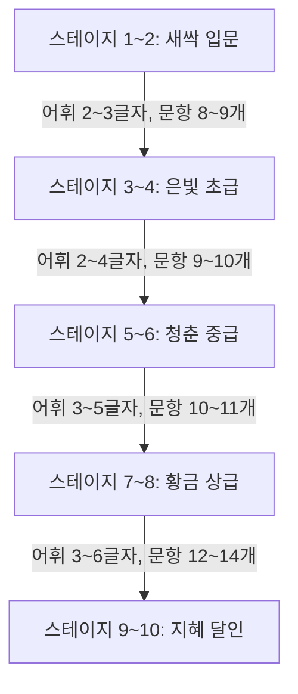

# 2026.10.14 시니어 맞춤형 10x10 가로세로 낱말퍼즐 100단계 전면 개선 계획서

## 1. 개요 및 개선 목적
어르신(시니어) 이용자의 두뇌 건강과 즐거운 퍼즐 경험을 극대화하기 위해, 기존 7x7 격자판 기반 시스템을 **10x10 고밀도 격자판**으로 전면 확장하고 이용 품질을 혁신적으로 개선합니다.

- **목표 1 (10x10 대형 격자 & 글자 가시성 극대화)**: 10x10 격자판으로 전환하되, 노안이나 저시력 어르신들도 돋보기 없이 선명하게 보실 수 있는 **스마트 포커스 줌 & 고대비 타이포그래피** 구현
- **목표 2 (단계별 문항 수 증대)**: 단계당 6~7문항에 불과하던 단순 구성을 **8~14문항**의 풍부한 퍼즐망으로 대폭 확대
- **목표 3 (질문 중복률 0.0% 달성)**: 기존 197개 단어 풀의 반복 출제를 완전히 없애고, **1,000개 이상의 엄선된 고유 시니어 친화 어휘 사전** 구축
- **목표 4 (10단계 점진적 난이도 곡선)**: 1단계부터 100단계까지 스테이지별로 글자 수, 어휘 난이도, 교차 복잡도를 정교하게 차등화
- **목표 5 (시니어 친화 부가 기능 고도화)**: 초성 힌트, 편리한 터치 내비게이션, 오프라인 음성 낭독 연동, 두뇌 활력 성취감 시스템 도입

---

## 2. 현황 분석 및 개선 필요성 (AS-IS vs TO-BE)

| 구분 | 현재 상태 (AS-IS) | 개선 목표 (TO-BE) |
|---|---|---|
| **격자판 크기** | 7x7 (총 49칸) | **10x10 (총 100칸)** |
| **단계당 문항 수** | 평균 6 ~ 7문항 | **8 ~ 14문항 (난이도별 점증)** |
| **어휘 풀 규모** | 총 250개 단어 | **1,000개 이상 완전 고유 어휘 풀** |
| **질문 중복 현황** | 100단계 중 유니크 질문 197개 (동일 문제 평균 3.5회 이상 중복) | **100단계 전 구간 질문/단어 중복률 0.0%** (모든 문제가 새로운 단어) |
| **난이도 설계** | 스테이지 1~10 간 난이도 편차 미미 | **입문(2~3자 일상어)부터 달인(4~6자 사자성어)까지 5계층 정밀 분격** |
| **모바일 글자 가시성** | 7x7 고정 렌더링, 폰트 조절 시 화면 밀림 위험 | **스마트 포커스 줌(현재 단어 자동 확대) + 3단 글자 크기 + 10x10 최적화** |
| **음성 낭독 (TTS)** | 700문항 사전 생성 MP3 | **1,000+개 전 문항 고음질 MP3 전수 사전 생성 및 PWA 오프라인 캐싱** |

---

## 3. 핵심 개선 항목별 상세 설계

### [개선 1] 10x10 격자판 전환 및 시니어 시력 보호 UI/UX 혁신

#### 1) 문제점 및 도전 과제
스마트폰 화면(폭 360~412px 기준)에서 칸수가 7개에서 10개로 늘어나면 단순 축소 시 1칸당 크기가 약 45px에서 32px 수준으로 줄어들어, 시력이 약한 어르신들이 글자를 확인하고 터치하기 어려워질 수 있습니다.

#### 2) 시니어 맞춤 가시성 극대화 솔루션
1. **스마트 포커스 줌 (Smart Focus Zoom & Pan)**:
   - 전체 판을 한눈에 볼 수 있는 **'전체 조망 뷰'**와, 현재 풀고 있는 단어 주변을 140~160% 크게 확대해 보여주는 **'포커스 줌 뷰'**를 부드럽게 전환.
   - 단어를 터치하거나 하단 슬롯을 누르면 해당 단어가 있는 영역이 보드 중앙으로 자동 스크롤/포커스 이동.
2. **초고대비/초대형 글꼴 렌더링**:
   - 셀 내부 숫자(1, 2, 3...)는 좌상단에 최소 크기(10~11px)로 배치하여 글자 공간을 최대로 확보.
   - 입력된 한글 글자는 `font-weight: 800 (Extra Bold)`, 글자색 순수 흑색 `#000000`, 배경 선명한 백색/노란색으로 시인성 200% 향상.
3. **가로/세로 방향 강조 하이라이트**:
   - 현재 단어의 활성 칸은 **황금 오렌지색(`#FDE047` / `#F59E0B`)**, 연관 교차 칸은 **부드러운 연노랑(`#FEF9C3`)**으로 구분하여 노안 어르신도 시선 분산 없이 집중 가능.
4. **여백 극대화 및 미니멀 헤더**:
   - 모바일 화면의 불필요한 패딩을 2px 단위까지 압축하여 격자판에 화면 높이와 너비의 65% 이상을 할당.

---

### [개선 2] 단계별 문항 수 증대 및 유기적 격자망 설계

1. **단계별 문항 수 기준**:
   - **초급 (스테이지 1~3)**: **8 ~ 9문항** (가로 4~5개, 세로 4개)
   - **중급 (스테이지 4~7)**: **10 ~ 11문항** (가로 5~6개, 세로 5개)
   - **상급 (스테이지 8~10)**: **12 ~ 14문항** (가로 6~7개, 세로 6~7개)
2. **높은 교차 밀도(Interlocking Quality)**:
   - 고립된 단어(혼자 떨어져 있는 단어)를 0건으로 통제하고, 모든 단어가 최소 1개 이상(평균 2~3개) 다른 단어와 교차하도록 알고리즘 제약 조건 설정.
   - 앞 단어를 맞히면 교차 글자가 힌트가 되어 다음 단어를 쉽게 연상할 수 있도록 유기적 퍼즐감 극대화.

---

### [개선 3] 질문 중복 제로(Zero)화: 1,000개 이상 대규모 시니어 맞춤 어휘 사전 구축

100단계 × 단계당 평균 10문항 = **총 1,000개 이상의 100% 비중복 단어 풀**을 구축합니다.

#### 어휘 테마 및 카테고리 구성 (어르신들의 흥미와 추억 소환)
1. **정겨운 고향과 옛 생활 도구 (180단어)**
   - 예: 맷돌, 가마솥, 디딜방아, 인절미, 장독대, 풍로, 지게, 조리, 물레, 키, 놋그릇 등
2. **세시풍속과 전통 문화 / 명절 (150단어)**
   - 예: 대보름, 윷놀이, 부럼, 창포물, 백중날, 동지팥죽, 차례, 길쌈, 한가위 등
3. **건강 / 음식 / 자연 / 계절 (220단어)**
   - 예: 된장찌개, 도라지, 둥굴레, 혈액순환, 관절, 단풍놀이, 매화, 진달래, 보약 등
4. **추억의 문화 / 가요 / 지리 (180단어)**
   - 예: 동백아가씨, 신라의달밤, 한강다리, 백두산, 한라산, 남산타워, 완행열차 등
5. **교양 / 사자성어 / 미담 (270단어)**
   - 예: 일석이조, 고진감래, 유비무환, 전화위복, 동병상련, 백년해로, 역지사지 등

#### 중복 검증 자동화
- 퍼즐 생성기 빌드 시 전체 100단계에 등장하는 단어 및 Clue를 `Set`으로 추출하여 중복 발생 시 빌드가 실패하도록 자동 검증 테스트(`verify_no_duplicates.js`) 파이프라인 구축.

---

### [개선 4] 10개 스테이지 난이도 단계별 상승 곡선 (Progression Balance)

어르신들이 초반에는 자신감을 얻고, 후반부로 갈수록 성취감과 두뇌 자극을 느끼실 수 있도록 체계적인 5계층 난이도 체계를 적용합니다.



| 난이도 등급 | 해당 스테이지 | 단계수 | 단어 길이 | 주요 어휘 성격 | 단계당 문항수 | 힌트 난이도 |
|---|---|---|---|---|---|---|
| **1계층: 새싹 (입문)** | 스테이지 1~2 | 20단계 | 2~3글자 | 친숙한 일상 가전, 음식, 가족, 동물 | 8~9개 | 매우 쉽고 직관적인 설명 |
| **2계층: 은빛 (초급)** | 스테이지 3~4 | 20단계 | 2~4글자 | 생활 도구, 건강, 계절, 동식물 | 9~10개 | 쉬운 비유 및 연상 힌트 |
| **3계층: 청춘 (중급)** | 스테이지 5~6 | 20단계 | 3~4글자 | 기본 사자성어, 전래동화, 옛 지명 | 10~11개 | 표준 속담 및 유래 힌트 |
| **4계층: 황금 (상급)** | 스테이지 7~8 | 20단계 | 3~5글자 | 중급 고사성어, 한국사, 문화재 | 11~12개 | 역사적 배경 및 교양 힌트 |
| **5계층: 지혜 (달인)** | 스테이지 9~10 | 20단계 | 4~6글자 | 심화 사자성어, 문학, 전통 어휘 | 12~14개 | 깊이 있는 두뇌 자극 힌트 |

---

### [개선 5] 시니어 사용성 강화를 위한 추가 혁신 기능 제안

1. **초성 힌트 및 한 글자 열기 (2단계 힌트 시스템)**
   - 기존에는 무조건 전체 단어를 채워주는 힌트만 제공되었으나, 스스로 생각하는 재미를 보존하기 위해:
     - 1차 힌트: **'초성 보기'** (예: "ㅅㅅㅇㅂ")
     - 2차 힌트: **'한 글자 열기'** (선택한 칸의 정답 1자만 공개)
2. **음성 낭독(MP3 + Web Speech) 1,000문항 전수 탑재**
   - 신규 1,000개 어휘에 대해 빌드 타임 Node.js 배치 스크립트로 MP3 오디오 파일 자동 생성.
   - PWA Service Worker의 오디오 전용 캐시(`senior-crossword-audio-v2`)와 연동하여 100% 오프라인 무음 방지.
3. **두뇌 건강 점수 및 일일 칭찬 피드백**
   - 단계 클리어 시 "대단하십니다! 뇌 나이가 10년 젊어지셨습니다!", "오늘도 뇌 활력 만점!" 등 긍정적이고 따뜻한 시니어 전용 칭찬 모달 제공.
4. **좌우 스와이프 간편 문제 이동**
   - 문제 힌트 영역을 좌우로 쓱 밀거나(스와이프), 큼직한 `[이전 문제] [다음 문제]` 터치 버튼으로 복잡한 칸 클릭 없이 순서대로 풀 수 있는 편의 제공.

---

## 4. 시스템 아키텍처 및 세부 구현 계획

### 1) 파일 구조 개편 및 모듈 역할
```
Crossword_puzzle/
├── audio/                      # 사전 생성된 1,000+개 MP3 음성 파일
├── docs/                       # 기획, 개선 계획서 및 개발 일지
│   ├── 2026.10.14_시니어_가로세로_낱말퍼즐_100단계_PWA_구축.md
│   └── 2026.10.14_10x10_가로세로_낱말퍼즐_전면_개선_계획서.md
├── scripts/
│   ├── vocabulary_1000.json   # [신규] 1,000개 이상 시니어 검증 어휘 DB
│   ├── generator_10x10.js     # [신규] 10x10 전용 백트래킹 퍼즐 자동 배치 엔진
│   ├── generate_puzzles.js    # 100단계 전수 생성 및 난이도 분배 스크립트
│   ├── verify_puzzles.js      # 중복 0건 및 10x10 격자 무결성 전수 검증 스크립트
│   ├── audio_util.js          # 음성 파일명 해시 매핑 유틸
│   ├── generate_audio.js      # MP3 배치 생성 스크립트
│   └── build_app.js           # 10x10 UI, 스마트 줌, PWA 통합 index.html 빌더
├── index.html                  # 최종 싱글 정적 웹앱 (10x10 UI + 100단계 데이터)
├── manifest.json               # PWA 매니페스트
└── sw.js                       # Service Worker (10x10 및 신규 오디오 캐시 v6)
```

### 2) 10x10 퍼즐 생성 백트래킹 알고리즘 사양
- **격자 크기**: 10행 × 10열 (0~9 인덱스)
- **밀도 목표**: 전체 100칸 중 45~65칸이 글자 칸으로 채워짐
- **교차성 보장**: 모든 단어는 최소 1개, 최대 word.length-1개의 다른 단어와 직교 교차
- **인접 충돌 방지**: 평행하게 인접한 칸 사이에 원치 않는 2글자 단어가 우연히 형성되는 현상(Parallel Adjacency Violation)을 100% 검사하여 차단

---

## 5. 단계별 추진 로드맵 (Roadmap)

| 단계 | 작업 내용 | 세부 산출물 |
|---|---|---|
| **Phase 1: 어휘 DB 구축** | 1,000개 이상 고유 시니어 어휘 및 친절한 해설 데이터 작성, 5단계 난이도 등급 태깅 | `scripts/vocabulary_1000.json` |
| **Phase 2: 10x10 생성 엔진** | 10x10 백트래킹 퍼즐 생성 알고리즘 구현, 100단계 전수 생성 및 중복 0건 검증 | `generator_10x10.js`, `puzzles_100.json` |
| **Phase 3: UI/UX 고도화** | 10x10 고대비 격자판, 스마트 포커스 줌, 10음절 터치 자판 가독성 극대화 | `scripts/build_app.js` UI 템플릿 개편 |
| **Phase 4: 음성 파이프라인** | 신규 어휘 MP3 전수 생성, Service Worker v6 캐싱 연동 | `audio/*.mp3`, `sw.js` 업데이트 |
| **Phase 5: 검증 및 배포** | PC 및 모바일 PWA 최종 브라우저 테스트, 로컬 서버 재실행, GitHub Pages 배포 | `index.html` 배포, GitHub 커밋 |

---

## 6. 결론 및 기대 효과
이번 10x10 전면 개선을 통해:
1. 100단계 내내 **단 한 번도 중복되지 않는 1,000개의 신선한 문제**를 풀 수 있어 게임의 질과 볼륨이 비약적으로 향상됩니다.
2. 10x10 격자로 문항 수가 2배 가까이 풍성해지면서도, **스마트 포커스 줌 기능**을 통해 시력이 약한 어르신들도 답답함 없이 시원시원하고 큼직하게 퍼즐을 즐기실 수 있습니다.
3. 입문 단계부터 달인 단계까지 정교한 난이도 사다리를 제공하여 지속적인 두뇌 활력과 높은 성취감을 선사합니다.
