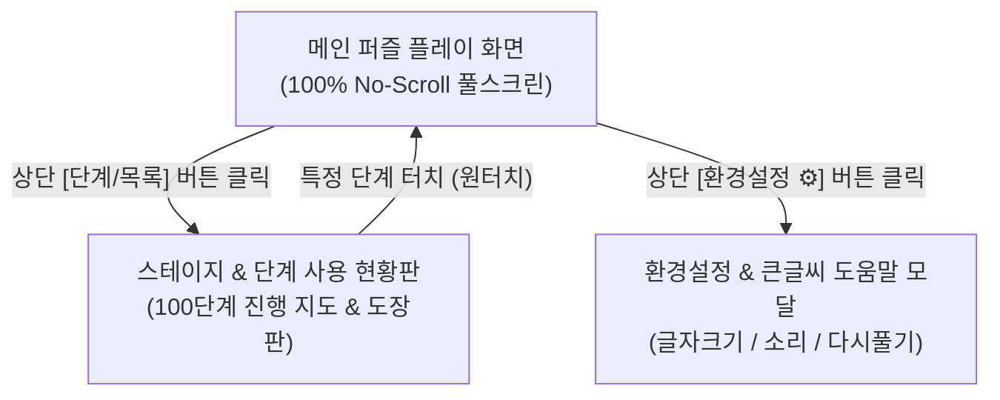

# 시니어 맞춤형 10x10 낱말퍼즐 UI/UX 전면 개편 및 화면 분할 제안서

- **작성일자**: 2026년 10월 15일
- **프로젝트**: 청춘 10x10 가로세로 낱말 퍼즐 100
- **문서 위치**: `C:\Antigravity\Crossword_puzzle\docs\2026.10.15_시니어_맞춤_UIUX_전면_개편_및_화면분할_제안서.md`
- **목적**: 스마트폰 환경에서 스크롤 없이 한눈에 들어오는(No-Scroll Viewport) 시니어 최적화 화면 설계 및 기능별 다중 화면 분할 방안 제안

---

## 1. 현황 진단 및 문제점 분석

### 1.1 스마트폰 화면 내 UI 결함 분석 (사용자 지적 사항)

```
[현재 index.html 단일 페이지의 세로 누적 높이: 약 1,070px]
┌──────────────────────────────────────────────┐
│ PWA 설치 배너 (45px)                         │
├──────────────────────────────────────────────┤
│ 상단 헤더: 제목 + 소리 + 3단 글자크기 (60px) │ ──> [작게/중간/크게] 우측 잘림 발생!
├──────────────────────────────────────────────┤
│ 스테이지/단계 드롭다운 + 진행률 바 (95px)    │ ──> 세로 공간 과다 점유 (불필요한 인지 부하)
├──────────────────────────────────────────────┤
│ 10x10 격자판 (380~420px)                     │
├──────────────────────────────────────────────┤
│ 현재 문제 설명 카드 + 정답 슬롯 (150px)      │
├──────────────────────────────────────────────┤ ─── 스마트폰 실제 뷰포트 하단선 (약 680~740px)
│ 가상 자판 (10개 한글 키패드) (110px)         │ ─── [화면 밖으로 잘림]
├──────────────────────────────────────────────┤
│ 기능 버튼: [지우기] [전체] [힌트] [확인] (50px)│ ─── [스크롤해야만 노출되는 치명적 불편]
└──────────────────────────────────────────────┘
```

1. **상단 컨트롤 요소 가로 잘림 (Overflow)**:
   - 타이틀("청춘 낱말 퍼즐 10×10 100단계")과 소리 토글 버튼, 3단 글자 크기 조절기("작게/중간/크게")가 가로 1행에 배치되어 있어, 폭 360~400px의 모바일 환경에서 "크게" 버튼의 우측 텍스트가 화면 밖으로 잘려 나감.
2. **세로 높이 초과로 인한 필수 액션 버튼 가림**:
   - 상단 헤더 및 드롭다운 선택기가 세로 약 200px을 차지함에 따라, 전체 컨텐츠 높이가 약 1,070px에 달함.
   - 스마트폰 표준 뷰포트(높이 667~844px)에서 가장 중요한 **입력 자판 하단 및 [지우기], [전체], [힌트], [확인] 버튼이 화면 아래로 잘려 매번 스크롤을 내려야 하는 심각한 불편** 발생.
3. **시니어 사용자의 조작 실패 위험**:
   - 어르신들은 화면 스크롤 시 오터치가 발생하거나 현재 커서 위치를 놓치기 쉬움.
   - 퍼즐을 풀 때는 **"격자판 + 문제 힌트 + 입력 자판 + 확인/지우기 버튼"이 무조건 한 화면(No-Scroll Viewport)**에 고정되어야 함.

---

## 2. 전면 개편 전략: 3개 화면 분할 및 단일 뷰포트(No-Scroll) 구축

기존 `index.html` 단일 페이지에 모든 기능을 욱여넣던 구조에서 벗어나, 기능과 목적에 따라 **3개의 직관적인 전용 화면/모달로 분할**합니다.



---

## 3. 화면별 상세 구조 및 UI 개선안

### 3.1 [화면 1] 🧩 메인 퍼즐 화면 (Game Play Viewport) - "완전 무스크롤 100% 핏"

메인 화면의 모든 요소는 스마트폰 화면 높이(100vh) 안에 엄격하게 계산되어 들어가며, 상하 스크롤이 완전히 비활성화됩니다.

```
┌────────────────────────────────────────────────────────┐
│ ☰ 단계목록        스테이지 1 - 2단계        🔊 소리  ⚙ 설정│ ── [초슬림 탑바: 44px]
├────────────────────────────────────────────────────────┤
│                                                        │
│                  10 × 10 퍼즐 격자판                   │ ── [반응형 격자: 화면폭 기준 자동 스케일]
│            (고대비 흰색 셀 / 선명한 번호)              │
│                                                        │
├────────────────────────────────────────────────────────┤
│ ⬇ 세로 1번 (4글자) [문제 듣기 🔊]                       │ ── [콤팩트 문제 카드: 64px]
│ 콩나물을 넣고 파 마늘을 띄워 속을 풀어주는 시원한 국   │    (문제 + 정답 슬롯 통합 인라인)
│ [ 콩 ] [ 나 ] [ 물 ] [ 국 ]                            │
├────────────────────────────────────────────────────────┤
│  [거]    [문]    [기]    [은]    [탕]                  │ ── [시니어 특대 터치 자판: 100px]
│  [동]    [산]    [부]    [덕]    [알]                  │    (오터치 방지 굵은 볼더 & 햅틱)
├────────────────────────────────────────────────────────┤
│  [ ⬅ 지우기 ]   [ 💡 힌트 ]   [ ✔ 정답 확인 ]          │ ── [필수 액션 바: 44px]
└────────────────────────────────────────────────────────┘
  ★ 전체 높이 100vh에 완벽 밀착 ──> 위아래 스크롤 전혀 없음!
```

#### 세부 개선 요소:
1. **초슬림 탑바 (44px 고정)**:
   - 공간을 낭비하던 드롭다운 2개와 진행률 바를 완전히 제거.
   - 좌측: `[☰ 단계목록]` 버튼 (현황판으로 이동).
   - 중앙: `스테이지 1 - 2단계` 큰 텍스트 (터치 시 빠른 이동 드롭다운 팝업).
   - 우측: `[🔊]`, `[⚙ 설정]` 아이콘 버튼.
2. **슬림형 문제 안내 & 인라인 정답 슬롯 (64px)**:
   - 방향 배지(가로/세로), 글자 수, `[문제 듣기]` 버튼을 1행에 배치.
   - 2행에 크고 또렷한 문제 본문 설명 배치.
   - 3행에 콤팩트한 글자 입력 슬롯 배치.
3. **시니어 친화 특대 자판 & 하단 3대 핵심 액션 바**:
   - 10개 한글 음절 버튼: 세로 45px 이상의 큼직한 터치 영역 확보.
   - 하단 액션 버튼을 가장 많이 쓰는 3개로 압축:
     - `[ ⬅ 지우기 ]` (연분홍 경고색)
     - `[ 💡 힌트 ]` (노란색 주목도)
     - `[ ✔ 정답 확인 ]` (진한 파란색 대표 액션)
   - 스크롤 없이 엄지손가락으로 즉시 터치 가능.

---

### 3.2 [화면 2] 📊 스테이지 & 단계 사용 현황판 (Stage Map Screen)

상단 탑바의 `[☰ 단계목록]` 버튼을 누르면 부드럽게 슬라이드 전환되는 전용 대시보드 화면입니다.

```
┌────────────────────────────────────────────────────────┐
│  ← 뒤로가기              전체 진행 현황                │
├────────────────────────────────────────────────────────┤
│  🏆 전체 달성도: 18 / 100 단계 (18%)                   │
│  [████████░░░░░░░░░░░░░░░░░░░░░░░░░░░░░░]               │
├────────────────────────────────────────────────────────┤
│  [스테이지 1: 새싹 입문] (완료 8/10)                   │
│  ┌───┬───┬───┬───┬───┐                                │
│  │ 1단계│ 2단계│ 3단계│ 4단계│ 5단계│  (초록색: 참 잘했어요 도장)
│  │ ★★★│ ★★★│ ★★★│ ★★★│ ★★★│  (노란색: 진행 중)
│  ├───┼───┼───┼───┼───┤  (회색: 미도전)
│  │ 6단계│ 7단계│ 8단계│ 9단계│10단계│                                │
│  │ ★★★│ ★★★│ ★★★│  ▶  │     │                                │
│  └───┴───┴───┴───┴───┘                                │
├────────────────────────────────────────────────────────┤
│  [스테이지 2: 은빛 초급] (완료 5/10)                   │
│  ... (스크롤하여 100단계 전체를 시원하게 탐색)         │
└────────────────────────────────────────────────────────┘
```

#### 세부 개선 요소:
1. **시니어 눈높이의 큰 버튼 타일 (Tile Grid)**:
   - 복잡한 셀렉트 박스 대신, 큼직한 네모 타일 버튼으로 1~10단계를 직관적으로 나열.
   - 푼 단계는 초록색 바탕에 "완료(도장/별)" 표시, 현재 단계는 강조 테두리 표시.
2. **원터치 단계 진입**:
   - 원하는 단계 타일을 손가락으로 툭 누르면 즉시 해당 단계 퍼즐로 이동.
3. **성취감 부여**:
   - 단계별 완료 현황과 전체 진척도를 한눈에 확인하여 두뇌 운동의 동기 부여 극대화.

---

### 3.3 [화면 3] ⚙️ 환경설정 & 시니어 도움말 모달 (Settings Modal)

상단 탑바의 `[⚙ 설정]` 버튼을 누르면 화면 중앙에 큼직하게 열리는 팝업 모달입니다.

```
┌────────────────────────────────────────────────────────┐
│                      ⚙ 환경설정                        │
├────────────────────────────────────────────────────────┤
│  [글자 크기 조절]                                      │
│  ( ) 보통 글자     (●) 큰 글자     ( ) 아주 큰 글자    │
│  ※ 어르신 눈에 가장 편안한 크기를 선택하세요.         │
├────────────────────────────────────────────────────────┤
│  [음성 안내 (소리)]                                    │
│  [● 켜짐]  새 문제 선택 시 자동으로 문제 읽어주기     │
├────────────────────────────────────────────────────────┤
│  [단계 초기화]                                         │
│  [ 🔄 현재 단계 처음부터 다시 풀기 ]                   │
├────────────────────────────────────────────────────────┤
│  [도움말]                                              │
│  📖 낱말퍼즐 푸는 방법 및 힌트 사용법 보기             │
├────────────────────────────────────────────────────────┤
│                     [ 닫기 (확인) ]                    │
└────────────────────────────────────────────────────────┘
```

#### 세부 개선 요소:
1. **버튼 텍스트 잘림 근본 해결**:
   - 좁은 헤더 1행에 끼워 넣었던 글자 크기 조절기를 모달 내부로 이동하여, 큼직한 3개 라디오/토글 버튼으로 여유 있게 배치.
2. **소리 자동 읽기 옵션**:
   - 문제를 탭했을 때 자동으로 TTS 음성이 나오게 할지 선택 가능.
3. **실수 방지**:
   - "다시 풀기" 버튼을 자판 밑에서 설정 모달 안으로 이동하여 실수로 누르는 일 원천 차단.

---

## 4. 모바일 뷰포트 높이 예산표 (Viewport Height Budget)

스마트폰 기준 높이(iPhone SE: 667px / 일반 안드로이드: 740~800px) 기준으로 100% 핏을 달성하기 위한 구체적인 세로 픽셀 배분표입니다:

| UI 구성 요소 | 기존 높이 | **개편 후 높이** | 절감 효과 및 세부 설계 |
| :--- | :---: | :---: | :--- |
| **PWA 설치 배너** | 45px | **상단 플로팅/닫기 가능** | 메인 퍼즐 영역에 영향 최소화 |
| **상단 헤더/탑바** | 155px | **44px** | **-111px 절감** (드롭다운/진행률 별도 화면 분리) |
| **10×10 격자판 (Board)** | 380px | **350~370px** | 격자 셀 패딩 최적화로 한눈에 꽉 차게 렌더링 |
| **문제 설명 & 정답 슬롯** | 150px | **70px** | **-80px 절감** (인라인 배치 및 불필요 여백 제거) |
| **터치 키패드 (2행 5열)** | 110px | **95px** | 버튼 터치감은 유지하되 행간 마진 4px로 슬림화 |
| **핵심 액션 바 (3대 버튼)**| 50px | **42px** | [지우기], [힌트], [확인] 3버튼 최적 배치 |
| **합계 (Total Height)** | **890px (스크롤 발생)** | **약 600~640px** | **★ 100% 한 화면에 안착 (스크롤 0px 달성)** |

---

## 5. 단계별 구현 추진 계획

사용자 피드백 및 승인 후 다음 순서로 개편을 진행합니다:

1. **1단계 (HTML/CSS 레이아웃 구조 개편)**:
   - 초슬림 탑바(44px) 구축 및 기존 헤더 내 드롭다운/진행률 바 제거.
   - 메인 퍼즐 뷰를 `height: 100vh; overflow: hidden;` 단일 뷰포트로 전환.
   - 키패드와 액션 바를 결합하여 스크롤 없이 하단에 완벽 밀착.
2. **2단계 (스테이지 & 단계 사용 현황판 전용 화면 구현)**:
   - 10개 스테이지 탭 및 100단계 대형 타일 그리드 UI 제작.
   - 로컬스토리지 완료 상태와 실시간 연동 (완료 도장, 진행 중 표시).
   - 탑바 `[☰]` 버튼 클릭 시 부드러운 화면 전환(Slide/Fade) 처리.
3. **3단계 (환경설정 & 큰글씨 도움말 모달 구현)**:
   - 3단 글자 크기 조절 라디오 UI 및 음성 옵션 설정창 구축.
   - 시니어 맞춤 큼직한 한글 도움말 탑재.
4. **4단계 (모바일 실기기 반응형 전수 검증 및 빌드)**:
   - 화면비율(iPhone SE부터 대화면 갤럭시 울트라까지) 뷰포트 밀착 검증.
   - `build_app.js` 재빌드, 서비스워커 캐시 갱신(`v10`), 실서버 재실행 및 GitHub 백업.

---

> **본 제안에 대한 의견이나 추가로 반영하고자 하시는 사항이 있으시면 말씀해 주시기 바랍니다. 확인해 주시면 즉시 1단계 화면 개편 구현에 착수하겠습니다.**
