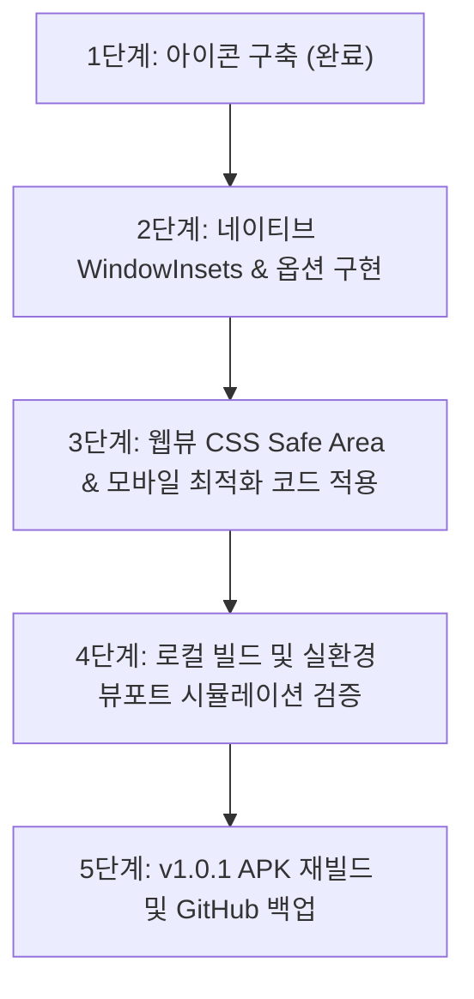

# 스마트폰 UI 겹침 해결, 아이콘 제작 및 앱 최적화 개선 계획서

- **작성일자**: 2026년 10월 17일
- **작업명**: 스마트폰 상/하단 기능 버튼 겹침 해결, `icon.svg` 기반 앱 런처 아이콘 제작 및 모바일 실환경 최적화 개선 계획
- **대상 프로젝트**: [Crossword_puzzle](file:///C:/Antigravity/Crossword_puzzle)

---

## 1. 개요 및 실환경 문제 진단

사용자가 제공한 실제 스마트폰 구동 캡처 이미지를 분석한 결과, 모바일 실환경에서 원활한 플레이를 심각하게 저해하는 **상/하단 UI 겹침 현상**과 **앱 아이콘 미적용** 문제가 확인되었습니다.

### 🔍 첨부 이미지 기반 문제점 진단

```
┌─────────────────────────────────────────────────────────────┐
│ 🔴 [최상단 겹침] 통신사(KT), 시계, 배터리(65%) 상태바가       │
│    앱의 파란색 브랜드 바('청춘 10x10 낱말퍼즐') 텍스트와 정면 충돌  │
├─────────────────────────────────────────────────────────────┤
│                                                             │
│                    10×10 퍼즐 그리드 본문                    │
│                                                             │
├─────────────────────────────────────────────────────────────┤
│                                                             │
│                    10글자 시니어 한글 키패드                 │
│                                                             │
├─────────────────────────────────────────────────────────────┤
│ 🔴 [최하단 겹침] 소프트웨어 내비게이션 바(소프트키 버튼 3종)    │
│    [최근앱 |||]      [홈버튼 ○]       [뒤로가기 <]          │
│    ↑                  ↑                ↑                   │
│    [⬅ 지우기]         [💡 힌트]        [✔ 확인]             │
│    앱 핵심 조작 버튼 위를 시스템 버튼이 완전히 덮고 있어          │
│    확인이나 지우기를 누를 때 홈/뒤로가기가 잘못 터치됨!         │
└─────────────────────────────────────────────────────────────┘
```

1. **최상단 시스템 상태바(Status Bar) 충돌**:
   - 통신사명, 배터리 잔량, 시계, 알림 아이콘이 앱의 최상단 브랜드 타이틀과 겹쳐서 가독성이 훼손되고 지저분하게 보임.
2. **최하단 소프트웨어 내비게이션 바(Navigation Bar) 충돌 (치명적)**:
   - 스마트폰 하단 3버튼(`|||`, `○`, `<`)이 앱의 가장 중요한 `[⬅ 지우기]`, `[💡 힌트]`, `[✔ 확인]` 버튼 위를 그대로 덮고 있음.
   - 시니어 어르신이 정답을 입력하고 '확인'을 누르려다가 실수로 스마트폰 '뒤로가기'나 '홈'을 터치하여 게임에서 튕겨 나가는 치명적인 오작동 유발.
3. **앱 실행 아이콘 부재**:
   - 고품질 벡터 아이콘인 `icon.svg`가 존재함에도 불구하고 안드로이드 설치 시 기본 초록색 로봇 아이콘으로 표시되어 앱의 품격과 시인성이 떨어짐.

---

## 2. 원인 심층 분석

1. **Android 15 / 16 (API 35/36) Edge-to-Edge 강제 정책**:
   - 최신 안드로이드 버전에서는 앱 뷰가 상태표시줄과 내비게이션바 영역 뒤까지 화면 전체(0, 0 ~ W, H)를 덮도록 강제(Edge-to-Edge)됩니다.
   - 네이티브 컨테이너(`MainActivity`)에서 `WindowInsets` 패딩을 처리하지 않으면 콘텐츠가 시스템 바 영역을 침범하게 됩니다.
2. **웹 뷰포트 높이 계산의 불일치**:
   - 기존 CSS의 `height: 100vh`는 하단 소프트키 내비게이션 바가 차지하는 물리적 높이(약 48dp~56dp)를 제외하지 못하여 콘텐츠 하단부가 소프트키 영역 아래로 파묻히게 됩니다.
3. **Adaptive Icon 리소스 미동기화**:
   - 안드로이드 리소스 폴더(`res/drawable`, `res/mipmap-*`)에 기본 템플릿 로봇 이미지가 남아있어 벡터 SVG 아이콘이 반영되지 못함.

---

## 3. 핵심 개선 과제 및 해결 방안

### [과제 1] 상단/하단 스마트폰 기능 버튼 겹침 해결 (3중 안전 설계)

| 구분 | 적용 위치 | 기술적 구현 내용 | 기대 효과 |
| :--- | :--- | :--- | :--- |
| **① 네이티브 Insets 자동 패딩** | `MainActivity.kt` | `ViewCompat.setOnApplyWindowInsetsListener`를 루트 레이아웃에 적용하여 `statusBars()` 높이와 `navigationBars()` 높이를 실시간 감지하여 WebView에 마진/패딩 부여 | 상단 상태바와 하단 소프트키 높이만큼 컨텐츠가 밀려나와 100% 안전 영역 확보 |
| **② 시스템 바 색상 분리 및 몰입감 유지** | `MainActivity.kt` | 상태바 배경은 로열 블루(`#1D4ED8`), 내비게이션 바 배경은 앱 바닥 크림베이지(`#FAF8F5`)로 설정 | 소프트키가 앱의 조작 버튼과 겹치지 않고 자연스럽게 하단에 독립 배치됨 |
| **③ 웹뷰 Safe Area CSS 연동** | `index.html` | 메타태그에 `viewport-fit=cover` 명시 및 상단 브랜드바에 `padding-top: env(safe-area-inset-top)`, 하단 버튼 그룹에 `padding-bottom: env(safe-area-inset-bottom)` 보강 | 웹 브라우저 및 PWA 환경에서도 Safe Area 완벽 준수 |
| **④ 동적 뷰포트 높이 단위(`100dvh`)** | `index.html` (CSS) | `height: 100vh` 대신 `height: 100dvh` 또는 `height: calc(100% - safe-area)`로 핏 최적화 | 가로/세로 스크롤바 0px 유지 및 10x10 격자 한눈에 표시 |

---

### [과제 2] `icon.svg` 기반 고해상도 앱 런처 아이콘 제작 및 반영 (선행 완료)

`icon.svg`의 디자인 원형을 100% 보존하면서 안드로이드의 모든 기종과 런처 규격에 부합하도록 아이콘 패키지를 제작 및 구축 완료했습니다.

1. **아이콘 하단 배지 텍스트 최신화**:
   - 기존 `7×7 100단계` 표기를 현재 앱의 실제 스펙인 **`10×10 100단계`**로 수정 완료.
2. **Adaptive Icon (Android 8.0 ~ Android 16 최신 폰 대응)**:
   - `res/drawable/ic_launcher_background.xml`: 브랜드 로열 블루 그라데이션(`#2563EB` ~ `#1D4ED8`) 및 은은한 격자 패턴 벡터 구축.
   - `res/drawable/ic_launcher_foreground.xml`: 2×2 낱말 퍼즐 타일(청/춘/낱/말)과 10×10 배지, 상단 별 장식을 정밀한 벡터 드로어블로 구현.
3. **전 해상도별 고화질 비트맵 아이콘 생성 및 레거시 제거**:
   - `mipmap-mdpi` (48×48px), `mipmap-hdpi` (72×72px), `mipmap-xhdpi` (96×96px), `mipmap-xxhdpi` (144×144px), `mipmap-xxxhdpi` (192×192px), Google Play 스토어용 (512×512px).
   - 각 규격별 사각 라운드 아이콘(`ic_launcher.png`)과 원형 아이콘(`ic_launcher_round.png`) 생성 완료.
   - 기존 템플릿의 초록 로봇 webp 파일 전량 삭제 완료.

---

### [과제 3] 스마트폰 실환경 사용성 극대화를 위한 추가 개선사항 6종

시니어 어르신들이 스마트폰에서 매일 편안하게 두뇌 퍼즐을 즐기실 수 있도록 필수 모바일 최적화 기능을 추가 반영합니다:

#### 1) 화면 세로 모드 고정 (`screenOrientation="portrait"`)
- **문제점**: 소파에 눕거나 비스듬히 손을 기울였을 때 가로(Landscape)로 화면이 회전되어 10x10 격자와 키패드가 깨지고 스크롤이 발생함.
- **개선안**: `AndroidManifest.xml`의 액티비티에 `android:screenOrientation="portrait"`를 선언하여 언제나 안정적인 세로 전용 뷰 유지.

#### 2) 화면 자동 꺼짐(Sleep) 방지 (`FLAG_KEEP_SCREEN_ON`)
- **문제점**: 어르신들은 문제를 읽고 단어를 고민하시는 데 30초~1분 이상 소요됩니다. 스마트폰 기본 설정(15~30초)으로 인해 화면이 자꾸 꺼지면 매우 큰 불편을 겪으심.
- **개선안**: 퍼즐 앱이 켜져 있는 동안에는 화면이 자동으로 꺼지지 않도록 `window.addFlags(WindowManager.LayoutParams.FLAG_KEEP_SCREEN_ON)` 적용.

#### 3) 화면 더블 탭 확대(Double-Tap Zoom) 및 핀치 줌 방지
- **문제점**: 키패드 버튼이나 확인/지우기를 빠르게 두 번 탭했을 때 브라우저가 '확대 제스처'로 오인하여 화면이 200% 커져버리는 현상.
- **개선안**: 
  - CSS에 `touch-action: manipulation;` 및 `-webkit-text-size-adjust: 100%;` 적용.
  - WebView 설정에 `settings.setSupportZoom(false)`, `settings.builtInZoomControls = false` 지정.

#### 4) 텍스트 롱 터치 시 돋보기/복사/붙여넣기 툴바 방지
- **문제점**: 퍼즐 칸이나 힌트 지문을 손가락으로 누르고 있을 때 시스템의 '텍스트 선택(복사/검색)' 팝업이 떠서 지문과 버튼을 가리는 문제.
- **개선안**: CSS에서 `user-select: none;`, `-webkit-user-select: none;`, `-webkit-touch-callout: none;`를 지정하여 불필요한 시스템 팝업 원천 차단.

#### 5) 하드웨어 볼륨 버튼 누를 때 미디어(음성) 볼륨 연동
- **문제점**: "문제 듣기" 소리가 작아서 스마트폰 옆면의 볼륨 버튼을 눌렀을 때 벨소리 볼륨이 조절되어 음성 소리를 키우지 못하는 문제.
- **개선안**: `MainActivity.kt`에서 `volumeControlStream = AudioManager.STREAM_MUSIC`을 선언하여 물리 버튼으로 즉각 음성 낭독 볼륨 조절 가능.

#### 6) 시스템 가상 키보드(소프트키보드) 팝업 차단
- **문제점**: 퍼즐 화면 터치 시 스마트폰 기본 쿼티 키보드가 화면 하단에서 불쑥 올라와 퍼즐 키패드를 덮어버리는 오작동 방지.
- **개선안**: `windowSoftInputMode="stateAlwaysHidden|adjustResize"` 및 WebView 가상 포커스 억제.

---

## 4. 단계별 실행 계획



| 단계 | 주요 작업 내용 | 담당 파일 |
| :---: | :--- | :--- |
| **1단계 (완료)** | `icon.svg` 10x10 수정, Adaptive Icon 벡터 및 해상도별 PNG 아이콘 생성 | `icon.svg`, `res/drawable/*`, `res/mipmap-*` |
| **2단계** | `MainActivity.kt`에 `WindowInsetsCompat` 상/하단 패딩, 화면 켜짐 유지, 미디어 볼륨 스트림 적용, `AndroidManifest.xml` 세로 고정 | `MainActivity.kt`, `AndroidManifest.xml` |
| **3단계** | `index.html`에 `viewport-fit=cover`, CSS `touch-action`, `user-select: none`, Safe Area 인셋 마진 보강 | `index.html`, `android/app/src/main/assets/index.html` |
| **4단계** | 안드로이드 `gradlew.bat assembleDebug` 재빌드 및 최신 `청춘10x10낱말퍼즐_100.apk` 갱신 | `청춘10x10낱말퍼즐_100.apk`, `SeniorCrossword_100.apk` |
| **5단계** | 작업 결과 보고서 작성 및 GitHub 백업 (`git push origin main`) | `docs/` |

---

## 5. 기대 효과

1. **상/하단 겹침 완전 해결**: 상태바(시계, 배터리)와 소프트키(홈, 뒤로가기)로부터 안전 거리를 확보하여, 시니어 사용자가 터치 실수 없이 쾌적하게 조작 가능.
2. **선명하고 고급스러운 전용 앱 아이콘**: 홈 화면에서 "청춘 10x10 낱말퍼즐" 로고가 또렷하게 표시되어 앱을 쉽게 찾고 실행할 수 있음.
3. **시니어 맞춤형 실환경 안정성**: 화면 꺼짐 방지, 세로 모드 고정, 더블 탭 확대 방지로 어르신들이 스트레스 없이 오직 퍼즐 풀이에만 몰입할 수 있는 최상의 환경 제공.