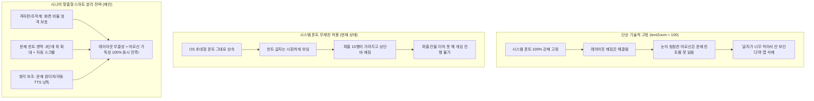
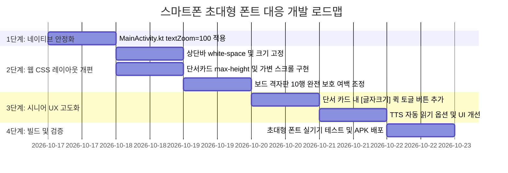

# 스마트폰 초대형 폰트(글자 크기) 설정 대응 UI/UX 개선 제안서

- **작성일자**: 2026년 10월 17일
- **프로젝트**: 청춘 10x10 가로세로 낱말 퍼즐 100 (`SeniorCrossword_100`)
- **문서 위치**: `c:\Antigravity\Crossword_puzzle\docs\2026.10.17_스마트폰_초대형_폰트_설정_대응_UIUX_개선_제안서.md`
- **목적**: 고령 어르신 사용자가 스마트폰 OS 설정에서 "글자 크기"를 최대로 설정했을 때 발생하는 화면 겹침 및 레이아웃 붕괴 현상을 진단하고, 시니어 접근성을 해치지 않으면서 게임을 완벽하게 즐길 수 있는 최선의 통합 해결 방안 제시

---

## 1. 문제 현황 및 현상 분석

### 1.1 첨부 이미지 현상 진단 (스크린샷 분석)

실제 어르신 사용자의 단말기(갤럭시 스마트폰 글자 크기 최대/특대 설정 상태)에서 캡처된 화면을 분석한 결과, 다음과 같은 치명적인 레이아웃 붕괴가 관찰되었습니다.

```
┌────────────────────────────────────────────────────────┐
│ 🧩 청춘 [10×10] 낱말퍼즐 [어르신 두뇌 건강]           │ ── [1. 상단 브랜딩 바]
│    (글자 2단 겹침, 10x10 거대화, 우측 뱃지 잘림)      │
├────────────────────────────────────────────────────────┤
│ (단계목록, 스테이지 타이틀, 음량, 설정 탑바 실종/겹침) │ ── [2. 상단 조작 탑바 겹침 은폐]
├────────────────────────────────────────────────────────┤
│  [1] [ ] [ ] [1] [ ] [2] [ ] [3] [ ] [ ]               │
│  [ ] [4] [ ] [5] [ ] [ ] [ ] [ ] [ ] [ ]               │ ── [3. 10x10 격자판]
│  ...                                                   │
│  [15][16][ ] [ ] [ ] [ ] [ ] [ ] [ ] [ ]               │
│ ┌────────────────────────────────────────────────────┐ │
│ │[ ] [ ] [ ] [17] ...                                │ │ ── [치명적 결함] 10행(17번 줄)이
│ │⬇ 세로 1번 (3글자)             🔊 문제 듣기          │ │    단서 카드 상단에 덮여 가려짐!
│ │여수와 제주도 사이 뱃길                             │ │ ── [4. 거대화된 문제 카드]
│ │요충지로 동백나무 숲과                              │ │    폰트가 2~3배 커지며 3줄 차지,
│ │등대가 유명한 섬                                    │ │    세로 높이가 폭발적으로 증가
│ │             [   ] [   ] [   ]                      │ │
│ └────────────────────────────────────────────────────┘ │
├────────────────────────────────────────────────────────┤
│  [ 강 ]  [ 거 ]  [ 꽃 ]  [ 다 ]  [ 달 ]                │ ── [5. 가상 키패드 10음절]
│  [ 도 ]  [ 들 ]  [ 문 ]  [ 바 ]  [ 산 ]                │
├────────────────────────────────────────────────────────┤
│  [ ⬅ 지우기 ]      [ 💡 힌트 ]      [ ✔ 확인 ]        │ ── [6. 하단 제어 액션 바]
└────────────────────────────────────────────────────────┘
```

1. **상단 브랜딩 바(`brand-bar`) 텍스트 겹침 및 이탈**:
   - 상단 헤더 높이가 `28px`로 고정되어 있으나, 시스템 폰트 확대(150%~200%)로 인해 `청춘`과 `낱말퍼즐`이 강제 2단 줄바꿈되면서 서로 겹침.
   - 중앙의 `10×10` 숫자가 비정상적으로 비대해져 영역을 벗어나고, 우측 `어르신 두뇌 건강` 뱃지의 텍스트 상하단이 잘려나감.
2. **상단 조작 탑바(`app-topbar`) 은폐**:
   - `단계목록`, `스테이지 1 - 1단계`, `소리 🔊`, `설정 ⚙` 버튼이 있는 38px 높이의 조작 바가 격자판 위쪽으로 밀리거나 겹쳐서 정상 조작이 불가능함.
3. **10x10 격자판 하단 행(10번째 줄, 17번 문항) 가림 현상 [가장 치명적]**:
   - 하단 문제 설명 카드(`clue-card`)가 거대해진 폰트 높이를 수용하기 위해 위쪽으로 팽창.
   - 결과적으로 10x10 격자의 맨 아랫줄(10행)과 `17번` 셀이 단서 카드 상단 모서리에 완전히 덮여버려 터치도 불가능하고 글자 확인도 불가능하여 **게임 클리어가 불가능한 상태**가 됨.
4. **문제 설명 카드(`clue-card`)의 비정상적 세로 점유**:
   - "여수와 제주도 사이 뱃길 요충지로 동백나무 숲과 등대가 유명한 섬"이라는 힌트 텍스트가 거대 폰트로 3줄을 꽉 채우며 세로 높이를 약 200px 이상 독식함.

---

### 1.2 근본 원인 규명

| 구분 | 발생 원인 | 기술적 세부 사항 |
| :--- | :--- | :--- |
| **안드로이드 네이티브 WebView** | `WebSettings.textZoom` 미제어 | 안드로이드 OS는 시스템 글자 크기(Font Scale)를 읽어와 WebView 내부의 모든 텍스트에 `textZoom` 배율(기본 130% ~ 200%)을 자동 상속함. 현재 `MainActivity.kt`에 이에 대한 방어 로직이 없음. |
| **웹 Flexbox 레이아웃 충돌** | `flex-shrink: 0`과 `aspect-ratio`의 충돌 | `.clue-card`와 `.touch-keyboard-card`에 `flex-shrink: 0`이 적용되어 있어 자식 요소 팽창 시 상위 뷰포트를 강제로 밀어올림. 반면 `.board-grid`는 정사각 비율(`aspect-ratio: 1/1`)을 유지하려다 하단이 가려짐. |
| **고정 높이 CSS 컨테이너** | `height` 고정값 설정 | `.brand-bar(28px)`, `.app-topbar(38px)` 등 고정 높이를 가진 컨테이너 내부에 시스템 확대 폰트가 유입되어 줄바꿈(Wrap) 및 글자 겹침 발생. |

---

## 2. 시니어 타깃 사용자의 특수성과 설계 딜레마

이 문제를 해결할 때 가장 주의해야 할 점은 **"단순한 기술적 차단"이 시니어 사용자 경험을 망칠 수 있다는 점**입니다.



- **어르신들이 시스템 글자 크기를 키우는 이유**:
  노안 및 시력 저하로 인해 스마트폰의 표준 글씨(14~16px)를 읽기 어렵기 때문입니다.
- **해결의 핵심 기준**:
  1. 10x10 퍼즐 보드는 한 치의 오차도 없이 **100개 칸 전체가 항상 온전하게 노출**되어야 함.
  2. 어르신이 가장 읽고 싶어 하는 **"문제 설명(단서)"은 큰 글씨로 시원하게 볼 수 있어야 함**.
  3. 시력이 극도로 저하된 어르신을 위해 **귀로 들을 수 있는 오디오(TTS) 지원**이 직관적으로 연계되어야 함.

---

## 3. 최선의 해결 방안 (4대 통합 솔루션)

### [방안 1] 안드로이드 네이티브 WebView: `textZoom` 안전 캡(100% 기준화) 적용

가장 먼저 OS 레벨의 무제한 텍스트 줌이 웹앱의 전체 골격을 무너뜨리지 못하도록 네이티브 단에서 기준선을 설정합니다.

- **적용 대상**: `MainActivity.kt`
- **구현 내용**:
  ```kotlin
  // MainActivity.kt - settings 블록 내부
  settings.apply {
      // 시스템 글자 크기 설정에 의해 웹뷰 전체 레이아웃이 왜곡되는 현상 원천 차단
      textZoom = 100
      
      // 기존 설정 유지
      javaScriptEnabled = true
      domStorageEnabled = true
      setSupportZoom(false)
      builtInZoomControls = false
      displayZoomControls = false
      ...
  }
  ```
- **효과**: 스마트폰 설정에서 글자 크기를 200%로 키우더라도, 상단 바 겹침이나 격자판 잘림 같은 기하학적 레이아웃 파괴 현상이 1차적으로 완벽히 차단됩니다.

---

### [방안 2] 웹 레이아웃 아키텍처 개편: "격자판 절대 보호 + 단서 카드 독립 가변형"

`textZoom = 100`을 적용하더라도 작은 화면(폭 320~360dp)이나 앱 내부 큰 글씨 설정 시 요소가 겹칠 수 있으므로, 웹 CSS의 공간 배분 구조를 근본적으로 개편합니다.

```
┌────────────────────────────────────────────────────────┐
│ [브랜딩 바] white-space: nowrap, 고정 텍스트 크기      │ ── flex-shrink: 0 (26px)
├────────────────────────────────────────────────────────┤
│ [조작 탑바] 단계목록 | 스테이지 타이틀 | 소리 | 설정   │ ── flex-shrink: 0 (36px)
├────────────────────────────────────────────────────────┤
│                                                        │
│               10 × 10 퍼즐 격자판                      │ ── [절대 보호 영역]
│       (어떤 경우에도 가려지지 않음, 10행 100% 노출)     │    flex-shrink: 1
│                                                        │    min-height: 0
├────────────────────────────────────────────────────────┤
│ ⬇ 세로 1번 (3글자)  [🔍 글자크기]  [🔊 문제 듣기]      │ ── [가변 및 스크롤 영역]
│ 여수와 제주도 사이 뱃길 요충지로 동백나무 숲과...      │    max-height: 22vh
│ [   ] [   ] [   ]                                      │    overflow-y: auto (넘치면 스크롤)
├────────────────────────────────────────────────────────┤
│ [가상 키패드 10음절]                                   │ ── flex-shrink: 0 (고정 보장)
├────────────────────────────────────────────────────────┤
│ [ ⬅ 지우기 ]       [ 💡 힌트 ]       [ ✔ 확인 ]       │ ── flex-shrink: 0 (고정 보장)
└────────────────────────────────────────────────────────┘
```

#### 세부 CSS 개선 명세:
1. **상단 바(`brand-bar`, `app-topbar`) 줄바꿈 및 겹침 방지**:
   ```css
   .brand-bar {
     height: 26px;
     min-height: 26px;
     white-space: nowrap; /* 글자 줄바꿈 원천 차단 */
     overflow: hidden;
   }
   .brand-title {
     font-size: 13px !important; /* 시스템 줌 독립적 절대 크기 보장 */
   }
   .brand-sub-badge {
     font-size: 9.5px !important;
     white-space: nowrap;
   }
   ```
2. **보드 격자판(`.board-card`)의 가시성 100% 확보**:
   - `flex-shrink: 1`, `min-height: 0`을 유지하되, 하단 단서 카드가 보드를 덮지 못하도록 `z-index`를 정리하고 일반적인 블록 흐름(Normal Flow)을 유지.
   - 10번째 행이 잘리지 않도록 `.board-grid`의 상하 여백 및 패딩 최적화.
3. **단서 카드(`.clue-card`)의 내부 스크롤 안전장치**:
   ```css
   .clue-card {
     flex-shrink: 0;
     max-height: 24vh; /* 화면 세로의 24%를 넘지 않도록 상한선 설정 */
     display: flex;
     flex-direction: column;
     gap: 3px;
   }
   .clue-text {
     /* 글자가 아무리 커져도 보드를 밀거나 가리지 않고 박스 안에서 부드럽게 스크롤 */
     max-height: 60px;
     overflow-y: auto;
     -webkit-overflow-scrolling: touch;
     word-break: keep-all;
     line-height: 1.35;
   }
   ```

---

### [방안 3] 시니어 특화 UX: 단서창 전용 "3단계 원터치 글자 확대 버튼" 도입

어르신이 문제를 볼 때 번거롭게 환경설정 모달을 열지 않고도, **문제 카드 바로 위에서 탭 한 번으로 글씨를 키울 수 있는 퀵 버튼**을 제공합니다.

```
┌────────────────────────────────────────────────────────┐
│ ⬇ 세로 1번 (3글자)       [🔍 글자크기 1.2x]  [🔊 듣기] │
│ ────────────────────────────────────────────────────── │
│ 여수와 제주도 사이 뱃길 요충지로 동백나무...          │
└────────────────────────────────────────────────────────┘
```

- **동작 방식**:
  - `[🔍 보통]` ➔ `[🔍 크게]` ➔ `[🔍 아주 크게]` 순환 토글 (또는 `[가+]` 버튼).
  - 글자 크기를 키우면 **오직 '문제 설명(단서)'과 '정답 슬롯'만 확대**되어, 퍼즐 판이나 키보드는 그대로 유지되면서 어르신이 가장 읽기 힘든 텍스트만 시원하게 커짐.
  - 선택한 글자 크기 설정은 `localStorage`에 자동 저장되어 다음 단계에서도 영구 유지.

---

### [방안 4] 청각적 접근성 강화: "문제 선택 시 자동 TTS 낭독" 모드

눈이 많이 침침하신 70~80대 고령 어르신을 위한 최고의 접근성 기능은 **음성 낭독(TTS)**입니다.

- **현재 상태**: 문제를 탭한 뒤 우측 상단의 `[🔊 문제 듣기]` 버튼을 매번 눌러야 함.
- **개선안**:
  1. **문제 자동 읽기(Auto-TTS) 옵션 추가**: 환경설정 또는 상단 스피커 아이콘을 길게 눌러 "새 문제 선택 시 자동으로 읽어주기" 옵션 제공.
  2. **문제 듣기 버튼의 시인성 향상**: 버튼 배경을 밝은 노란색/연두색 고대비로 강조하여 손쉽게 누를 수 있도록 유도.
  3. 글자를 읽기 어려운 어르신도 소리만 듣고 즉시 퍼즐을 풀 수 있어 시각적 폰트 크기 한계를 청각으로 완벽히 보완.

---

## 4. 해결 방안 종합 비교 평가

| 평가 항목 | 방안 A (기존 상태 방치) | 방안 B (단순 textZoom=100 고정) | **방안 C (제안: 4대 통합 솔루션)** |
| :--- | :---: | :---: | :---: |
| **10x10 격자판 100% 노출** | ❌ 10행 가려짐 (플레이 불가) | ✅ 완벽 노출 | **✅ 완벽 노출 (절대 보호)** |
| **상단 헤더/버튼 정상 작동** | ❌ 겹치고 깨짐 | ✅ 정상 작동 | **✅ 정상 작동 (줄바꿈 원천 차단)** |
| **시니어 가독성 (문제 힌트)** | ⚠️ 글자는 크나 판이 가려짐 | ❌ 글자가 너무 작아서 불만 | **✅ 3단계 퀵 조절로 대형 폰트 제공** |
| **작은 화면/DPI 호환성** | ❌ 심각한 레이아웃 파괴 | ⚠️ 텍스트는 보존되나 유연성 부족 | **✅ 가변 스크롤로 모든 화면 대응** |
| **시니어 청각 접근성 (TTS)** | ⚠️ 수동 터치만 지원 | ⚠️ 수동 터치만 지원 | **✅ 원터치 강조 + 자동 낭독 지원** |
| **구현 난이도 및 안정성** | - | 매우 낮음 (1줄 수정) | **보통 (검증된 웹/앱 수정, 1~2시간)** |

---

## 5. 단계별 실행 계획 (Implementation Roadmap)



### 세부 작업 절차
1. **1단계 (네이티브)**:
   - `MainActivity.kt`: `webView.settings.textZoom = 100` 추가
2. **2단계 (웹 CSS & 마크업)**:
   - `index.html`: `.brand-bar`, `.app-topbar`의 인라인 폰트 및 `white-space: nowrap` 적용
   - `.clue-card` 높이 상한선(`max-height: 24vh`) 및 `.clue-text`의 `overflow-y: auto` 적용
   - 10x10 격자판 하단 10번째 행이 단서 카드와 절대 닿지 않도록 마진 및 패딩 미세 조정
3. **3단계 (기능 고도화)**:
   - 문제 카드 영역에 🔍 폰트 배율 토글(`1.0x` / `1.15x` / `1.30x`) 버튼 구현
   - 글자 크기를 최대로 키워도 단서 박스 내에서 정갈하게 보이도록 연동
4. **4단계 (검증 및 빌드)**:
   - 스마트폰 설정에서 "글자 크기 최대" 및 "디스플레이 크기 최대" 상태에서 테스트
   - 신규 버전 APK 빌드 및 릴리즈

---

## 6. 결론 및 건의 사항

어르신 사용자가 스마트폰 폰트를 최대로 키우는 것은 **신체적 필요에 의한 자연스러운 행동**입니다. 따라서 단순히 시스템 폰트 상속을 막는 것만으로는 반쪽짜리 해결책에 불과합니다.

본 제안서에서 제시한 **"네이티브 textZoom 기준화 + 웹 레이아웃 충돌 방지 + 단서 영역 맞춤형 큰글씨 퀵 조절 + 청각 TTS 강화"**의 4대 통합 솔루션을 적용하면,
1. **격자판이 가려지는 치명적 결함을 100% 영구 해결**함과 동시에,
2. **어르신들이 원하시는 큼직한 문제 글씨와 편리한 음성 안내를 완벽하게 제공**할 수 있습니다.

사용자 검토 및 승인 후 즉시 해당 개선 작업을 착수할 것을 권장합니다.
